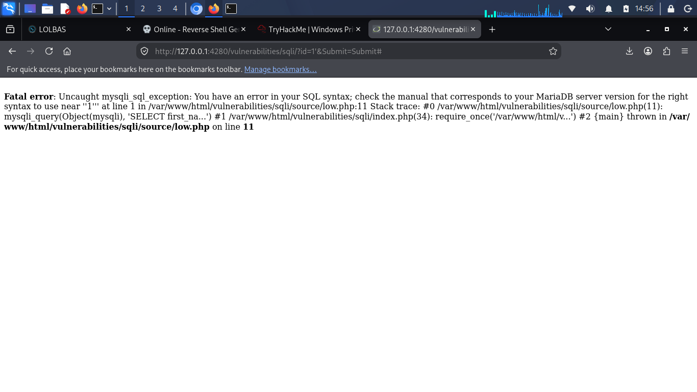

# Lab 01 — Error-Based SQL Injection (DVWA Low)

**Target:** DVWA — SQL Injection module
**Security Level:** Low
**Environment:** Local (localhost)
**Author:** Anyagu Chisom ([haloangel143](https://github.com/haloangel143))
**Date:** October 2026

---

## 1. Vulnerability

The `id` parameter is inserted directly into a SQL query without sanitization.

**Inferred query:**
```sql
SELECT first_name, last_name FROM users WHERE user_id = '$id';
```

## 2. Payload

```
1'
```

**Resulting query:**
```sql
SELECT first_name, last_name FROM users WHERE user_id = '1'';
```

The unmatched quote causes a syntax error.

## 3. Result

DVWA displayed a full database error message revealing:

- The database engine (MariaDB / MySQL)
- That input flows directly into the query
- That verbose errors are enabled



## 4. Impact

| Impact Area | Severity |
|-------------|----------|
| Information disclosure | Medium |
| Confirmation of injectable input | High |
| Precondition for data extraction | High |

**OWASP:** A03:2021 — Injection

## 5. Root Cause

- User input concatenated into SQL string
- No prepared statements
- Verbose SQL errors shown to the client

## 6. Remediation

**Parameterized query (PHP/PDO):**

```php
$stmt = $pdo->prepare("SELECT first_name, last_name FROM users WHERE user_id = ?");
$stmt->execute([$id]);
```

**Also:** disable verbose SQL errors, validate `id` is numeric, apply least privilege.

## 7. Next Step

The error confirms injectability. Lab 02 shows how to turn this into unauthorized data disclosure using boolean logic.
