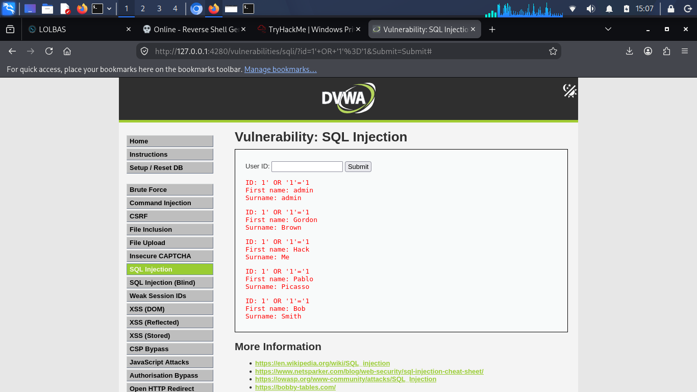

# Lab 02 — Boolean-Based SQL Injection (DVWA Low)

**Target:** DVWA — SQL Injection module
**Security Level:** Low
**Environment:** Local (localhost)
**Author:** Anyagu Chisom ([haloangel143](https://github.com/haloangel43))
**Date:** October 2026

---

## 1. Vulnerability

Same injectable `id` parameter as Lab 01. This time the payload manipulates the query logic so the WHERE clause always evaluates to TRUE.

**Inferred query:**
```sql
SELECT first_name, last_name FROM users WHERE user_id = '$id';
```

## 2. Payload

```
1' OR '1'='1
```

**Resulting query:**
```sql
SELECT first_name, last_name FROM users WHERE user_id = '1' OR '1'='1';
```

Because `'1'='1'` is always TRUE, the query returns every row in the `users` table.

## 3. Result

The application returned the first name and last name of all users in the database.



## 4. Why It Works

| Piece | Effect |
|-------|--------|
| `1'` | Closes the ID string |
| `OR '1'='1` | Always TRUE — bypasses the WHERE restriction |

The database is tricked into believing every row matches the condition.

## 5. Impact

| Impact Area | Severity |
|-------------|----------|
| Unauthorized disclosure of all user records | High |
| Enumeration of usernames | High |
| Precondition for credential theft | High |

**OWASP:** A03:2021 — Injection

## 6. Root Cause

- Direct concatenation of user input
- No type enforcement on `id`
- No parameterized queries

## 7. Remediation

**Parameterized query (PHP/PDO):**

```php
$stmt = $pdo->prepare("SELECT first_name, last_name FROM users WHERE user_id = ?");
$stmt->execute([$id]);
```

**Also:** cast `id` to integer (`$id = (int) $_GET['id'];`) before use.

## 8. Next Step

Lab 03 uses a UNION attack to pull data from other tables (e.g., usernames and password hashes) into the response.
